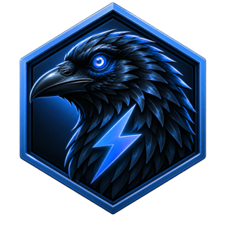
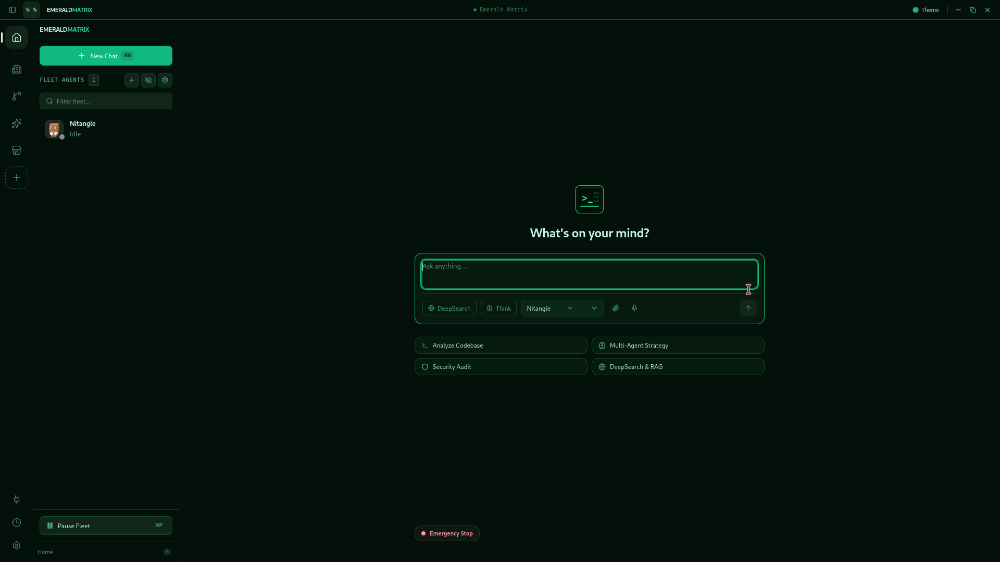
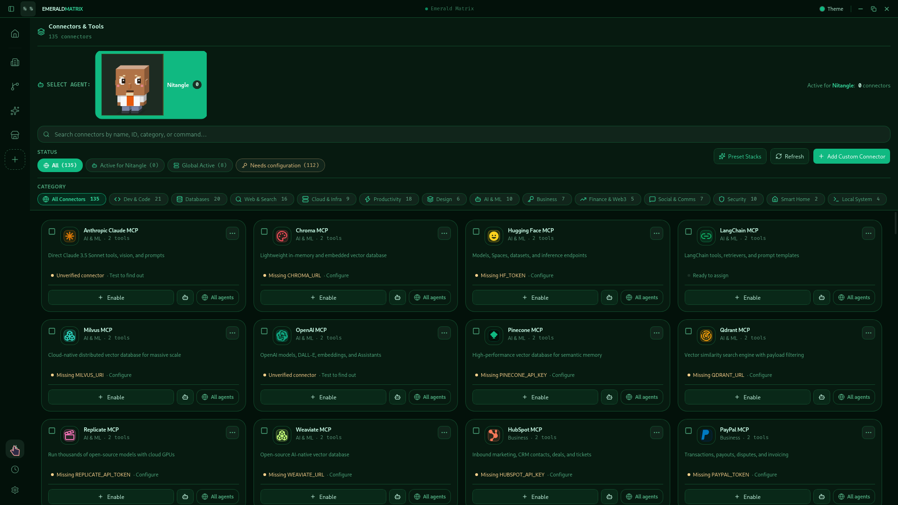
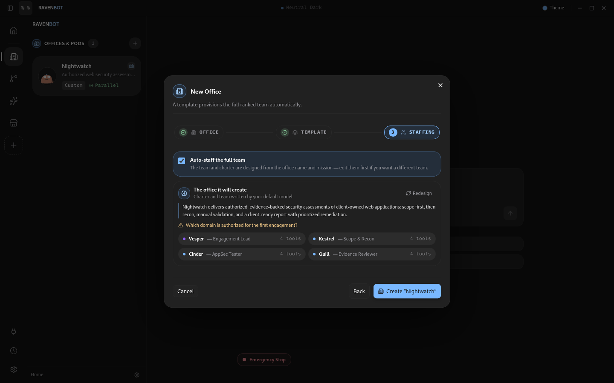
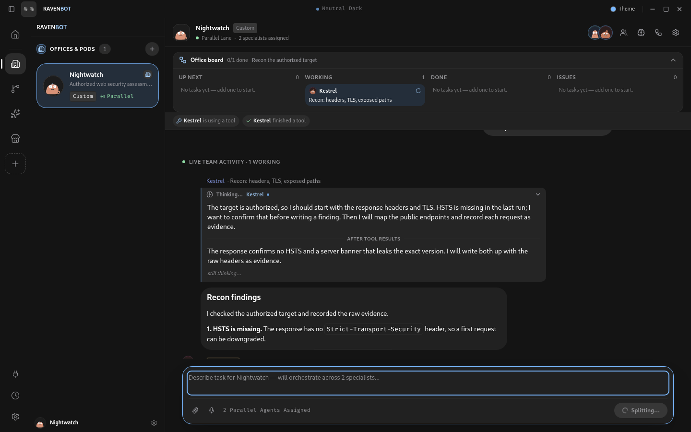
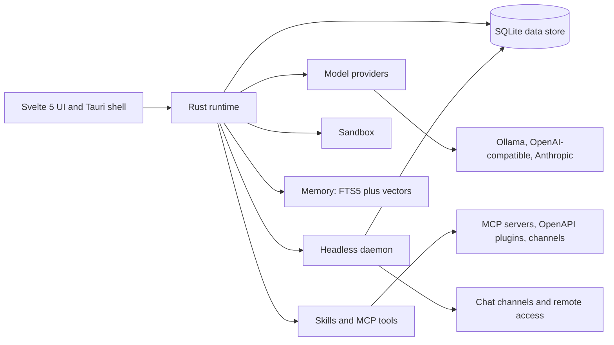

<p align="center">
  
</p>

<h1 align="center">RAVENBOT</h1>

<p align="center">
  <strong>A local-first agent workspace for people who need to know what their agents did.</strong><br>
  Persistent agents. Real tools. Offices that hand work to each other. All on your machine.
</p>

<p align="center">
  <a href="https://github.com/AetherRavyn/RAVENBOT/actions/workflows/ci.yml"></a>
  <a href="https://github.com/AetherRavyn/RAVENBOT/releases/latest"></a>
  
  
  
  
  
</p>

---

RAVENBOT is a desktop application, a headless daemon, and a CLI built around one
idea: an AI agent should be a real worker you can inspect, not a chat window
that forgets what happened yesterday.

Each agent has a name, a model, a set of tools, a memory, a sandbox, and its
own conversation. A lead agent can bring specialists into an **office** with a
shared workspace and a task board. Routines and offices keep running when the
window is closed. You can watch every tool call, approve the dangerous ones,
pause a run, cancel it, or stop the whole fleet with a kill switch.

The default model is local **Ollama**. You can also bring an API key for
OpenRouter, Anthropic, OpenAI, OpenCode Go, or any OpenAI-compatible endpoint.
Your database, memories, files, and audit trail live in `~/RAVENBOT`. No account
is required, and RAVENBOT does not send first-party telemetry.

> RAVENBOT is under active development. Linux is the most complete target;
> macOS and Windows builds exist, with the platform limits listed
> [below](#status-and-limits).

**Contents:** [Screenshots](#screenshots) · [Why RAVENBOT](#why-ravenbot) ·
[What you get](#what-you-get) · [Quick start](#quick-start) ·
[Providers](#providers) · [CLI](#cli) · [MCP](#use-ravenbot-from-another-mcp-client) ·
[Architecture](#architecture) · [Quality](#quality) · [Status and limits](#status-and-limits) ·
[Documentation](#documentation) · [Contributing](#contributing) · [License](#license)

## Why RAVENBOT

Most "AI agent" products are a chat box with a tool-call animation. RAVENBOT is
built like an operating layer:

- **You own the runtime.** Rust + SQLite + your filesystem. Bring a local model
  or a key you already pay for. Nothing needs to leave the machine.
- **Agents do actual work.** Read and edit files, run builds and tests, use Git,
  query databases, call HTTP APIs, drive a browser, control a desktop, and
  export documents, decks, charts, and video.
- **Work can be handed off.** Offices give each specialist a role, tools,
  memory, and a thread. A DAG-style plan runs independent nodes in parallel and
  writes the result back to the office board.
- **Nothing is a black box.** Every turn has a trace. Every tool call is in the
  audit ledger, and every high-risk approval records both the request and the
  decision that allowed or denied it — including headless, timeout, cancel and
  kill-switch exits. Approvals, budgets, sandboxes, and the kill switch are
  enforced by the runtime, not by a system prompt.
- **It keeps going.** A per-user service owns routines, scheduled workflows,
  offices, credential refresh, attention alerts, and remote access when the
  desktop window is gone.
- **It speaks your language.** Twelve interface locales — English, Spanish,
  French, German, Portuguese, Italian, Russian, Hindi, Turkish, Japanese,
  Korean, and Chinese — with full key and placeholder parity. The six newer
  locales are machine-assisted with a language-model review pass; native-speaker
  corrections are welcome, and RTL is deliberately not claimed yet.

## Screenshots

<p align="center">
  
  
</p>

**Left:** a conversation with live streaming, reasoning, tool traces, and the
fleet rail. **Right:** the connector centre, where a server names the exact
credential it needs before it can be assigned.

<p align="center">
  
  
</p>

**Left:** an office being designed from a mission, with a proposed roster and a
single clarifying question. **Right:** a live office run, with each agent's
reasoning kept separate from its answer.

## What you get

### A fleet, not a single chat

Give each agent a rank, a specialty, a model, a skill set, and its own workspace.
The lead agent (`The Raven` by default) designs offices from a one-line mission,
proposes the roster, and assigns only the skills and connectors that are actually
installed and configured on this machine. You can talk to the lead, mention a
specialist directly, or open any agent's thread and work with it one to one.
Conversations take their name from the first message, can be renamed or deleted
from the history drawer, and the last thread you opened for an agent is restored
after a reload. Narrow windows keep the conversation usable: secondary header
actions move into a **More** menu and the browser dock becomes an overlay rather
than squeezing the thread below its minimum width.

Local **accounts and workspace roles** let two people share one host without
sharing a database: each account keeps its own root, session and keychain
namespace, while the owner grants operator or viewer access to a workspace.
**Settings → Team** adds an existing account or creates one with a temporary
password, changes roles, and removes a member without touching their files.
Membership changes are audited, and every run records the acting account so the
Runs panel can say **by alice (operator)**. A work item can be claimed from its
task drawer: the database settles the race, only the current owner can release
it, and every claim and release lands in the task timeline.

### Start from a job, not a blank page

The **Job library** ships thirty installable jobs across marketing, sales,
engineering, operations, finance, people, research, and personal work. Each job
carries a role prompt, a routine instruction, a cadence, and an oversight level.
Installing one creates a real agent and a routine that is **paused from the
first row** — you read the instruction, adjust the schedule or oversight, and
enable it when it is actually ready. One-off jobs install as manual routines you
run with **Run now**. A visible welcome thread records what was installed and
what is still paused. The routines panel can also receive inbound webhook
content (including an email forwarded as JSON or form data); the content is
labelled as untrusted input, and high-risk tools still park for approval.

### Offices with real coordination

An office has a goal, a policy, shared memory, a document workspace, and a task
board. The planner builds a DAG, independent nodes run in parallel, and each node
gets its own thread so its reasoning and tool calls stay attributable. A node
that fails is reported as a failure instead of a misleading "done" card. A
background heartbeat starts the next turn when the office is idle, and stops on
a pending question, a budget ceiling, a kill switch, or repeated no-progress
cycles. Research answers keep their source chips in the office too, and a failed
load is an error with a retry rather than an empty room.

### Avatars that show the work

Every agent has a face, and the face follows the fleet. The generated Raven
face reacts to all seven roster moods, and an agent can instead pick a DiceBear
style or one of **23 bundled OpenBot characters** — small object characters
with eyes, drawn locally with no network request. The OpenBot studio previews
all six work states (**Idle, Thinking, Working, Waiting, Blocked, Done**) before
you apply, with body colour, volume, pointer-follow and flat, fluffy or glass
finishes. Live state comes from fleet activity: a waiting agent looks waiting, a
failed run looks blocked, and an unread reply celebrates. The studio selection
is a preview only; reloads keep the chosen character, colour, volume,
pointer-follow and finish. A person can also upload a PNG, JPEG, WebP or GIF
photo up to 512 KB as a custom avatar, replace it, or remove it without leaving
a broken image. See
[`docs/OPENBOT-AVATARS.md`](docs/OPENBOT-AVATARS.md).

### Memory that is retrieved, not dumped

Agent and office memories are stored in SQLite. Retrieval is hybrid: an FTS5
BM25 pass finds lexical candidates, then the configured embedding reranks them.
The default local embedding is a fast, offline word/bigram/character model; point
it at Ollama or an OpenAI-compatible embedding endpoint when you want true
semantic recall. Memory edits and deletes are visible in the UI, carry
source/thread/run provenance, and emit audit events. A fixed 50-fact benchmark in
Settings reports hybrid and vector-only Recall@5/MRR, so "it remembers" is a
measurement rather than a slogan.

### Tools that reach the real world

RAVENBOT ships with built-in skills for files, search, code edits, shell, Git,
Docker, databases, HTTP, memory, todos, questions, documents, slides, images,
voice, and computer control. It also supports:

- **MCP in both directions.** Use catalogued MCP servers from GitHub, Jira,
  Notion, Figma, Kubernetes, cloud providers, databases, and more. Run
  `ravenbot mcp-serve` to expose every RAVENBOT skill to Claude Code or any other
  MCP client.
- **Voice and recording import.** Hands-free STT→send→TTS in a thread, plus
  import of an existing WAV, MP3, OGG, M4A, WebM or FLAC recording (audio only,
  25 MiB cap) into a transcript-backed meeting-notes prompt. The composer's
  meeting-notes dialog shows the transcript preview and inserts a prompt you
  still review and send. This is not a live meeting join: RAVENBOT does not sit
  in calls, record calls, or label speakers.
  See [`docs/VOICE-MEETINGS.md`](docs/VOICE-MEETINGS.md).
- **Commerce with human checkout.** An agent can only create a pending spend
  request. The owner-only **Settings → Commerce** panel enforces a currency,
  per-request limit, UTC-daily limit and merchant allowlist, then approves or
  denies, opens the merchant's checkout in your browser, and records the result.
  RAVENBOT has no payment rail, card storage, order API, tax, shipping or
  currency conversion. See [`docs/COMMERCE.md`](docs/COMMERCE.md).
- **OpenAPI plugins.** Import an OpenAPI document as a local toolkit.
- **Community skills.** Search and install versioned skills from the VoltAgent
  marketplace, or write your own with the built-in skill authoring tools.
- **Learn from a run.** After a completed run, inspect its tool trace and get a
  deterministic draft of a versioned skill. Secrets are redacted, payloads are
  omitted, failed calls are excluded, and high-risk tools are flagged; nothing
  is saved or installed until you edit and approve it. See
  [`docs/LEARNING.md`](docs/LEARNING.md).
- **Teach a browser workflow.** Press **Teach** in the browser dock, do the task
  once, and press **Stop**. RAVENBOT synthesizes a reviewed skill from the
  recorded clicks, fills, presses and navigation, writes `demo.json` only after
  you save it, and later **Replay** tries recorded selector fallbacks before it
  stops with a concrete repair hint. Sensitive fields are never recorded and
  are left as manual steps. Browser-only; desktop capture and automatic DOM
  rewrite remain open. See [`docs/DEMONSTRATIONS.md`](docs/DEMONSTRATIONS.md).
- **Native chat channels.** Telegram, Slack, Discord, WhatsApp, and Microsoft
  Teams, with pairing codes, thread routing, attachments, and approval cards.
- **A browser dock and desktop control.** A real webview beside the conversation,
  DOM snapshots and actions for the agent, plus opt-in window/screen control,
  app launch, clipboard read/write, and drag on Linux. App launch and clipboard
  use native helpers on macOS and Windows; synthetic pointer/keyboard input is
  still Linux-only.

### Output people can open

Chat is not the only artifact. Agents can produce DOCX, PDF, PPTX, and HTML
documents; 1920×1080 designed slide decks; SVG charts; Mermaid diagrams; KaTeX
math; interactive HTML visuals; images; and MP4 motion graphics. Interactive
visuals can place a choice or page state into the composer, but never send it.
Tool traces carry a preview or an Open button, so the result is one click away
instead of a path buried in a paragraph.

### Autonomy with brakes

The default posture is useful autonomy, not blind autonomy:

- Reads, writes, builds, tests, and safe shell work proceed.
- A workspace-aware denylist blocks destructive disk, database, git-history, and
  out-of-workspace commands before an approval card is ever shown.
- A global inbox collects pending approvals and questions across every agent;
  the sidebar's **Waiting on me** filter reads the same live source, so a parked
  run is still discoverable after a reload.
- Unattended office, routine and channel runs use **Review**: reads and low-risk
  writes proceed, high-risk tools park for a person, and destructive operations
  are refused before a card is created.
- Destructive operations require an explicit decision in `Ask` mode; `Auto`
  gates high-risk calls; `Full` is the deliberate opt-in.
- The approval, question, and budget-confirmation waits all honor cancel and
  pause within 400 ms. Pausing parks a resumable run with a checkpoint.
- Budgets are checked before every model round. A provider circuit breaker stops
  repeated failures from burning time and money.
- The OS keychain is preferred for secrets. Without it, RAVENBOT seals secrets
  with XChaCha20-Poly1305 under `config/sealed-secrets` and keeps only a marker in
  SQLite. A copied database alone does not reveal them.
- An opt-in **enterprise export** streams redacted audit and run metadata to an
  OTLP/HTTP logs collector. Prompts, messages, tool arguments, file contents,
  thread titles, reasons and URL query strings never leave the machine; HTTP
  headers stay in the keychain and are never shown again. Delivery is
  cursor-based, with a background loop in the desktop app and headless daemon.
  See [`docs/ENTERPRISE-EXPORT.md`](docs/ENTERPRISE-EXPORT.md).

### Run it headless

`ravenbot daemon` owns the fleet with no window or display. It runs routines,
scheduled and webhook-triggered workflows, offices, audit maintenance, credential
refresh, attention notifications, and remote access. A per-user systemd unit,
macOS LaunchAgent, or Windows logon task can start it. An exclusive fleet lock
prevents two schedulers from fighting over the same database.

Remote access is off by default. When enabled, a paired phone or browser gets a
read/write client with viewer, operator, or admin roles, hashed tokens, device
revocation, and an audit trail. On an account workspace the device must also
sign in with a local RAVENBOT account, and the effective role is the lower of
the paired role and the account's workspace grant; disabling the account or
revoking its grant fails closed within a minute. An optional OIDC public-client
flow (authorization code + PKCE, RS256 only) can replace the password step for
an existing account; it never creates one. An optional SCIM 2.0 users endpoint
can provision and soft-deprovision workspace members with a separate
workspace-scoped bearer token and a viewer/operator default role. There are no
shell, filesystem, or settings endpoints on the remote listener.

## Quick start

### Install a prebuilt release

Prebuilt bundles are attached to [GitHub Releases](https://github.com/AetherRavyn/RAVENBOT/releases/latest):

| Platform | Bundle |
|---|---|
| Linux | AppImage, `.deb`, `.rpm` |
| macOS | `.dmg` (Apple Silicon + Intel) |
| Windows | NSIS `.exe`, WiX `.msi` |

```bash
# Linux AppImage
chmod +x RAVENBOT_*.AppImage
./RAVENBOT_*.AppImage
```

The current artifacts are unsigned. macOS may require right-click → **Open**, and
Windows may show SmartScreen. Verify the release checksums before running a
downloaded binary.

### Build from source

You need **Rust stable**, **Node 20+**, and the Tauri system dependencies for
your platform.

```bash
git clone git@github.com:AetherRavyn/RAVENBOT.git
cd RAVENBOT

npm install
npm run tauri dev
```

Linux packages (Debian/Ubuntu names):

```bash
sudo apt install libwebkit2gtk-4.1-dev libgtk-3-dev \
  libayatana-appindicator3-dev librsvg2-dev libdbus-1-dev \
  patchelf bubblewrap libssl-dev
```

macOS needs the Xcode command-line tools. Windows needs the MSVC build tools and
WebView2. For a release build:

```bash
npm run tauri build
```

The binary lands in `target/release/ravenbot`. The app uses `~/RAVENBOT` for its
database and data root; `RAVENBOT_DB` overrides the database path.

### First run

1. Start Ollama and pull a tool-capable model (for example
   `ollama pull llama3.1`), or add an API key in **Settings → Providers**.
2. RAVENBOT creates **The Raven**, the default lead agent. Give it a name and a
   model, or keep the defaults.
3. Start a thread and ask for something real: "read this repository and tell me
   what is broken", "run the tests and fix the first failure", or "design an
   office that audits this project".
4. Open the right-hand panels to inspect tool calls, reasoning, artifacts,
   approvals, and usage.

## Providers

RAVENBOT supports 20 providers, including local and custom endpoints.

| Provider | Notes |
|---|---|
| **Ollama** | Default; local, no key, no external model calls |
| **Local (in-process)** | Scaffolded provider; use Ollama for local inference today |
| **OpenRouter** | One key for many hosted models |
| **Anthropic** | Claude models |
| **OpenAI** | GPT models, including vision |
| **OpenCode / OpenCode Go** | Model lists synced from the live catalog; Claude routed to Go's Anthropic endpoint |
| **DeepSeek, Groq, Gemini, Mistral, Together, Perplexity, Cohere, xAI, MiMo, Cline, TokenRouter, Command Code** | Hosted APIs and compatible gateways |
| **Custom** | Any OpenAI-compatible, Anthropic-compatible, or Ollama endpoint |

Models are configured per agent and can be switched per conversation. A provider
manager tracks keys, base URLs, custom headers, rate limits, cooldowns, and a
circuit breaker. The same runtime handles streaming, tool calls, reasoning
channels, vision input, and token/cost accounting.

## CLI

The desktop app and the headless fleet share one binary.

```bash
ravenbot                                   # launch the desktop app
ravenbot --hidden                          # start in the tray
ravenbot run --bot Raven --message "Run the tests and fix the first failure"
ravenbot list-bots
ravenbot daemon                            # headless fleet owner
ravenbot service status                    # systemd/launchd/logon task
ravenbot service install
ravenbot remote pair --role operator       # pair a phone without a window
ravenbot mcp-serve                         # MCP server over stdio
ravenbot --help
```

Headless tool calls pause when `RAVENBOT_KILL_SWITCH=1` is set.

### Use RAVENBOT from another MCP client

```json
{
  "mcpServers": {
    "ravenbot": {
      "command": "ravenbot",
      "args": ["mcp-serve"]
    }
  }
}
```

Any MCP-speaking client can then list and call RAVENBOT's tools. The server uses
stdio, keeps the same database, and respects the same approval and safety
policy as the desktop app.

## Architecture



| Crate / directory | Responsibility |
|---|---|
| `crates/runtime` | Agent loop, offices, goals, approvals, tool dispatch, run ledger |
| `crates/models` | Provider clients, streaming, retries, token/cost accounting |
| `crates/skills` | Built-in tools, safety policy, skill registry |
| `crates/sandbox` | Bubblewrap, Seatbelt, Docker isolation and resource limits |
| `crates/memory` | Hybrid retrieval, local/remote embeddings, dedupe, self-review |
| `crates/db` | Schema migrations, queries, secrets, audit storage |
| `crates/mcp` | MCP client, connector catalog, MCP server |
| `crates/remote` | Remote listener, pairing, RBAC, public conversation shares |
| `src-tauri` | Desktop commands, CLI, daemon, service manager |
| `src` | Svelte UI, components, themes, i18n |

The design contracts are in [`docs/agent-harness.md`](docs/agent-harness.md) and
[`docs/design-system.md`](docs/design-system.md).

## Quality

RAVENBOT is tested at the boundaries that matter: the agent loop, approvals,
sandboxing, persistence, provider failure, memory retrieval, and the UI.

- **1,100+ Rust tests** across the workspace, including 262 Tauri library tests
  plus 7 cross-tenant isolation tests, 246 runtime tests, 223 skill tests, 122
  database tests, 89 core tests, 42 vision tests, 35 memory tests, 33 MCP
  tests, and 40 remote-access tests.
- **1,014 frontend tests** across 144 files. A gate rejects literal English
  `aria-label` values, and axe checks cover 20+ surfaces; accessible names follow
  the selected locale.
- `cargo test --workspace`, `cargo clippy --workspace --all-targets`,
  `npm run check`, and `npm test` are the local gates.
- CI runs the Rust workspace, the Docker sandbox live test, frontend checks, the
  frontend suite, `cargo audit`, `cargo-deny`, and macOS/Windows service
  contracts.

Useful evidence lives in [`CHANGELOG.md`](CHANGELOG.md) and
[`docs/COMPETITIVE-AUDIT-2026.md`](docs/COMPETITIVE-AUDIT-2026.md); both record
what changed and what is still missing.

## Status and limits

This is a working product, not a mock-up, but some edges are still honest
limitations rather than finished features:

- **Linux is the primary target.** Desktop, sandbox, daemon, Docker isolation,
  and desktop control are exercised here. Synthetic pointer, keyboard, and drag
  input is Linux-only; app launch and clipboard use native helpers on macOS and
  Windows. See [`docs/COMPUTER-USE.md`](docs/COMPUTER-USE.md).
- **macOS** builds and ships a default-deny Seatbelt profile, and can use Docker
  Desktop as a real container backend. The Seatbelt path still needs
  real-machine validation before it should be treated as equal to Linux.
- **Windows** builds and supports the desktop app, headless daemon, and logon
  task, but the command sandbox backend is not implemented yet. Agent shell
  commands are blocked rather than silently run unsandboxed.
- **Release artifacts are unsigned.** macOS Gatekeeper and Windows SmartScreen
  will warn until signing and notarization are configured. `SHA256SUMS.txt` and
  a CycloneDX SBOM are attached to every release; [`docs/RELEASE.md`](docs/RELEASE.md)
  documents the signing/updater setup.
- **The default memory backend is lexical, not neural.** It is fast and fully
  offline; use Ollama or an OpenAI-compatible embedding endpoint when you need
  semantic paraphrase recall. No bundled neural model is shipped.
- **In-process local inference is scaffolded, not shipped.** Ollama is the
  supported offline model path today; the `Local` provider returns an explicit
  "engine not linked" error instead of pretending to run.
- **Remote access is off by default.** It is a local listener with pairing and
  RBAC, not a hosted cloud service.
- **Remote SSO is optional and deliberately narrow.** OIDC authorization code +
  PKCE with RS256 ID tokens can sign in an **existing** local account. Owners
  configure it in **Settings → Remote → Single sign-on (OIDC)**; saving does
  not contact the IdP, so the first check happens when a paired device signs in.
  There is no group mapping, auto-provisioning, client secret or OIDC logout.
  SCIM user provisioning is a separate, off-by-default surface with its own
  workspace-scoped token, configured in **Settings → Remote → SCIM
  provisioning**; it can create a member with only the configured
  `viewer`/`operator` grant and never manages the owner or a shared account.
  See [`docs/REMOTE-SSO.md`](docs/REMOTE-SSO.md) and
  [`docs/REMOTE-SCIM.md`](docs/REMOTE-SCIM.md).
- **Agent email is draft-only.** An owner may configure one SMTP account; an
  agent can only create a plain-text draft, and a person must review and send
  it. A send atomically claims the draft before SMTP, so two clicks cannot send
  twice; a crashed send is recovered after ten minutes with a “verify with the
  recipient” warning. The owner-only **Settings → Mail** panel configures the
  account, lists drafts, and confirms every test, send and discard. There is no
  `email_send` tool, no auto-send, no inbound mail/IMAP, no attachments or HTML,
  and no provider OAuth. The password is keychain-backed, an address/domain
  allowlist is enforced at draft time, and a send audits only the draft id and
  recipient count. An invalid saved allowlist still loads in Mail for repair;
  sending stays blocked until it is fixed. See
  [`docs/AGENT-EMAIL.md`](docs/AGENT-EMAIL.md).
- **Commerce never spends.** The `spend_request` tool can only insert a pending
  request; the owner approves or denies it, and limits are re-checked at
  approval. Opening checkout is an external browser handoff, and “mark
  purchased” records a person's statement without verifying an order. There is
  no payment rail, card data, automated checkout, tax, shipping, refunds or
  currency conversion. See [`docs/COMMERCE.md`](docs/COMMERCE.md).
- **Voice is not a meeting bot.** Hands-free voice mode transcribes microphone
  speech, sends it to the agent, and speaks the reply. Recording import accepts
  an existing audio file (WAV, MP3, OGG, M4A, WebM or FLAC, 100 bytes–25 MiB) and
  returns a transcript capped at 60,000 characters for a meeting-notes prompt.
  The composer dialog previews the transcript and inserts the prompt without
  sending it. There is no live meeting join, calendar/platform integration,
  diarization, video import, phone-call support, or automatic sending of notes.
  OpenAI Whisper is a paid provider call; local faster-whisper is the offline
  path. See [`docs/VOICE-MEETINGS.md`](docs/VOICE-MEETINGS.md).
- **No first-party telemetry.** Provider calls, an optional OIDC IdP, configured
  MCP servers, optional remote alerts, an optional SCIM IdP, an optional agent
  SMTP account, and the opt-in enterprise export are the only outbound traffic
  the app initiates. The enterprise export sends logs only; SCIM Groups, OTLP
  metrics/traces, data-residency controls and a hosted relay are not shipped.
  See [`docs/ENTERPRISE-EXPORT.md`](docs/ENTERPRISE-EXPORT.md).
- **No paywall, license gate or built-in payment rail.** The app is MIT, has no
  trial, activation key, plan limit or feature paywall, and does not process
  cards or charge anyone. Optional model providers, Hugging Face inference and
  MCP connectors can bill you directly if you configure them; the Stripe and
  PayPal entries are catalog metadata for opt-in third-party connectors, not
  RAVENBOT billing. Commerce is owner-approved spend requests with an external
  browser checkout only. See [`docs/COMMERCE.md`](docs/COMMERCE.md).

The roadmap is tracked in [`ROADMAP.md`](ROADMAP.md). The code-level audit and
remaining trust gaps are in
[`docs/COMPETITIVE-AUDIT-2026.md`](docs/COMPETITIVE-AUDIT-2026.md); the current
market comparison against OpenClaw, Grok Bot, Hermes and Muse is in
[`docs/MARKET-COMPARISON-2026-11.md`](docs/MARKET-COMPARISON-2026-11.md).

## Documentation

| Document | What it covers |
|---|---|
| [`docs/agent-harness.md`](docs/agent-harness.md) | Tool discipline, budgets, guards, handoff, and verification |
| [`docs/COMPUTER-USE.md`](docs/COMPUTER-USE.md) | Desktop actions, platform matrix, approvals and honest limits |
| [`docs/ACCOUNTS.md`](docs/ACCOUNTS.md) | Local accounts, sessions, and workspace roles |
| [`docs/REMOTE-ACCESS.md`](docs/REMOTE-ACCESS.md) | Pairing, RBAC, and the remote listener |
| [`docs/REMOTE-SSO.md`](docs/REMOTE-SSO.md) | OIDC single sign-on: flow, configuration, account mapping, audit, limits |
| [`docs/REMOTE-SCIM.md`](docs/REMOTE-SCIM.md) | SCIM 2.0 users: token lifecycle, default role, tenant isolation, soft deprovision, limits |
| [`docs/SERVICE.md`](docs/SERVICE.md) | systemd, launchd, and Windows logon service |
| [`docs/RELEASE.md`](docs/RELEASE.md) | Signing, notarization, updater, checksums and SBOM |
| [`docs/CHAT-APPS.md`](docs/CHAT-APPS.md) | Telegram, Slack, Discord, WhatsApp, and Teams |
| [`docs/AGENT-EMAIL.md`](docs/AGENT-EMAIL.md) | Draft-only agent email: Mail panel, config, allowlist, storage, audit, limits |
| [`docs/COMMERCE.md`](docs/COMMERCE.md) | Spend requests, owner approval, limits, merchant allowlist and human checkout handoff |
| [`docs/VOICE-MEETINGS.md`](docs/VOICE-MEETINGS.md) | Hands-free voice mode, recording import, formats/limits, STT cost, honest limits |
| [`docs/design-system.md`](docs/design-system.md) | Tokens, layout grammar, and component contracts |
| [`docs/OPENBOT-AVATARS.md`](docs/OPENBOT-AVATARS.md) | The bundled OpenBot gallery, URL scheme, six work states, materials and fallbacks |
| [`docs/PLATFORM-GAP-PLAN.md`](docs/PLATFORM-GAP-PLAN.md) | Visual/tool gap plan from OpenBot 0.80.0, clean-room guardrails, phases, tests and release gates |
| [`docs/LOCALIZATION.md`](docs/LOCALIZATION.md) | Twelve locales, provenance, placeholder rules, and how to add one |
| [`docs/LEARNING.md`](docs/LEARNING.md) | Learning from a run: synthesis, redaction, review, provenance, and limits |
| [`docs/DEMONSTRATIONS.md`](docs/DEMONSTRATIONS.md) | Teach and replay a browser demonstration: capture, selectors, secrets, `demo.json`, repair reports, limits |
| [`docs/ENTERPRISE-EXPORT.md`](docs/ENTERPRISE-EXPORT.md) | OTLP/HTTP log export: fields, exclusions, cursors, headers and limits |
| [`docs/MARKET-COMPARISON-2026-11.md`](docs/MARKET-COMPARISON-2026-11.md) | OpenClaw, Grok Bot, Hermes, Muse and RAVENBOT, with the path to best in market |
| [`docs/LIVE-CHECKS.md`](docs/LIVE-CHECKS.md) | Opt-in provider and platform checks |
| [`docs/OPENCODE-PARITY.md`](docs/OPENCODE-PARITY.md) | Harness and rendering parity audit |
| [`ROADMAP.md`](ROADMAP.md) | Milestones and remaining work |

## Contributing

Issues and pull requests are welcome. Before opening a PR:

```bash
cargo fmt --all
cargo clippy --workspace --all-targets
cargo test --workspace
npm run check
npm test
```

Keep changes consistent with the surrounding code, add a regression test for a
bug fix, and describe the user-visible effect in the PR. Security-sensitive
changes should say what was attacked and what now blocks it. See
[`SECURITY.md`](SECURITY.md) for reporting a vulnerability.

## License

MIT. See [`LICENSE`](LICENSE).

---

<p align="center">
  
</p>

<p align="center">
  <strong>RAVENBOT</strong> — give your agents a real workspace, then watch what they do with it.
</p>
