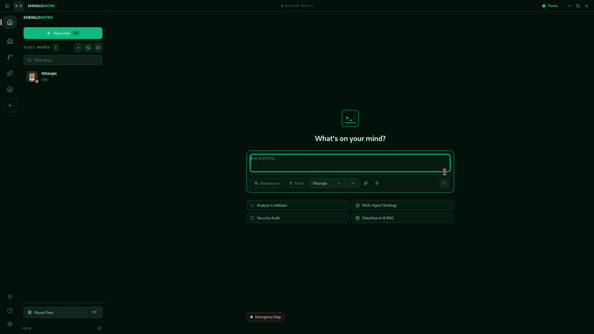
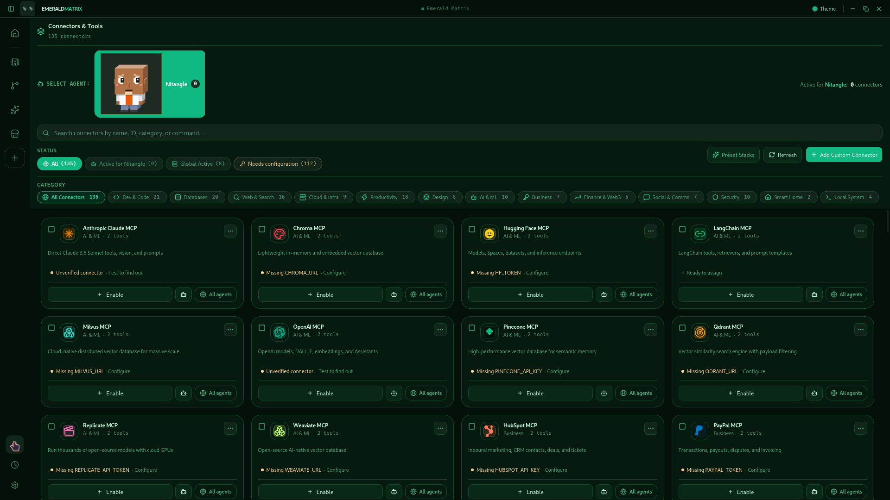
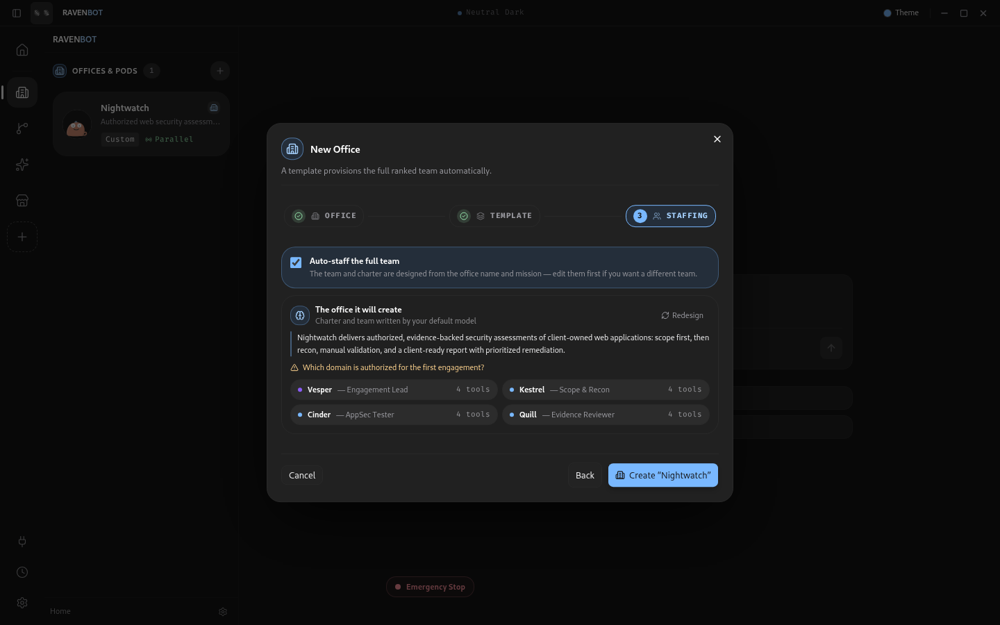
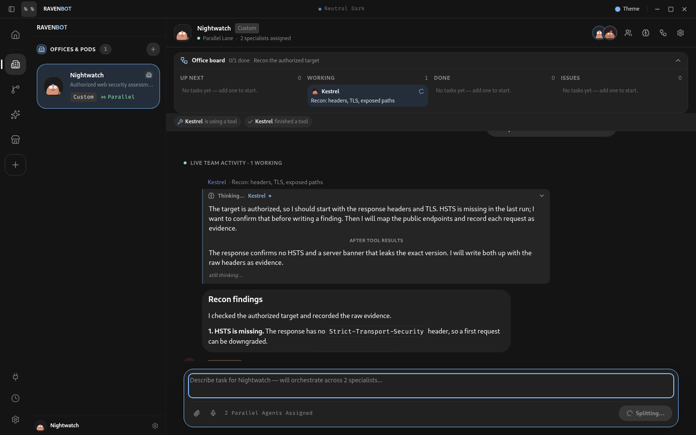
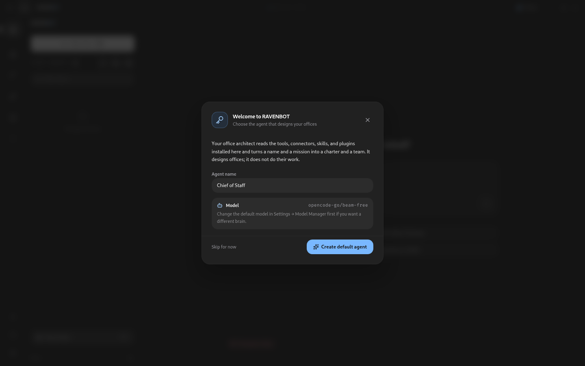
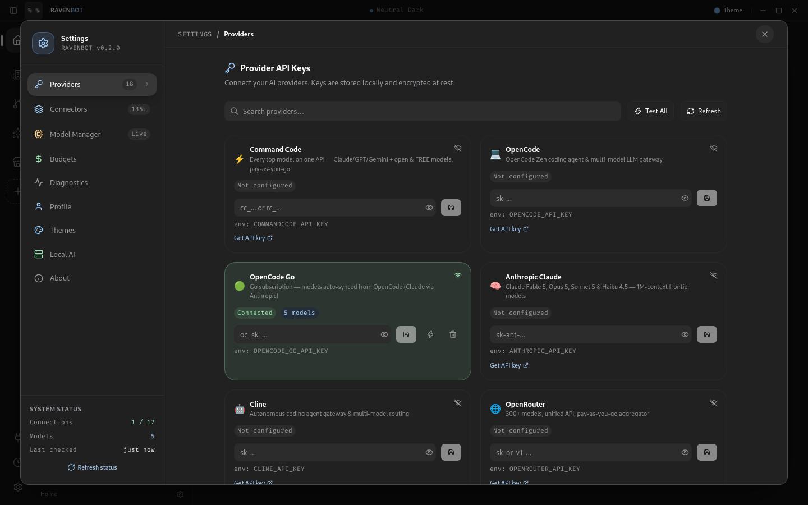

# RAVENBOT — Sovereign, Local-First, Rust-Native Multi-Agent Desktop OS

> **Not a chatbot — a fleet of persistent, specialized agents that live entirely on your machine.**

Each bot has an identity, a model, a skill set, a memory, a sandboxed computer, and a thread. One orchestrates the rest — exactly like your team. And unlike other AI apps, RAVENBOT both **consumes MCP** (135+ connector catalog) and **is an MCP server** — external agents like Claude Code can drive your entire fleet.

[](https://github.com/AetherRavyn/RAVENBOT/releases/latest)
[](https://github.com/AetherRavyn/RAVENBOT/actions/workflows/ci.yml)


---

## Screenshots

Captured from a running build at 1920×1080. The office captures below use the same UI against a deterministic IPC preview harness, so the streaming state is reproducible.

 

**Left** — the chat surface: composer with `[DeepSearch]` and `[Think]` toggles, the per-conversation model switcher, the fleet rail, and the reactive logo.
**Right** — the connector centre: 133 catalogued MCP servers, each card naming the exact environment key it needs and whether its launcher is verified.

 

**Left** — creating an office from a name and a one-line mission. The default model writes the charter, asks the one question that matters, and proposes the team before anything is created; the template is only the fallback.
**Right** — an office run in flight. Each agent's reasoning is visible above its answer, split by tool round, while the answer streams in rendered Markdown.

### Office design and request coordination

On first run, RAVENBOT asks for two things: a provider key and an **office architect** — a real agent with a name and a model. That agent designs every office. `draft_office_blueprint` gives it a live catalog of the built-in skills, the **enabled and configured MCP connectors**, and the **installed plugin toolkits** on this machine, then filters every returned assignment against that catalog. A role carries `skills`, `mcp_servers`, and `plugins`; provisioning assigns all three and rewrites `OFFICE.md` with the actual roster. An agent is never given a connector that is not installed, disabled, or missing its credentials.



Office graph nodes run in batches of three, and every model call passes through a per-provider governor: three requests in flight, spaced starts, and a shared cooldown after a 429 — so seven agents no longer become seven simultaneous requests and seven copies of the same error. A configuration-class failure (bad key, no credit, protocol mismatch) stops the run before the next batch.

If the planner's JSON is unusable, RAVENBOT uses a deterministic role plan: the lead writes the milestone to `Shared/STATUS.md`, and each specialist gets a distinct, specialty-scoped task instead of every agent receiving the same request. Native tool loops are also stopped — the second identical call is skipped, and a repeated loop is forced to a final answer.

### Autonomous offices, with a hard denylist

Office agents run without Allow/Deny cards. The safety boundary is a workspace-aware command denylist enforced in `shell_exec`, `task_runner`, and `docker`, not a prompt:

- recursive deletes are allowed **inside any configured office folder**, including custom folders and multiple project roots
- the office root itself, a top-level wildcard, `.git`, any path outside the roots, and symlinks pointing outside are blocked
- `cd`/`pushd` out of the workspace is blocked, so a relative `rm` cannot escape
- destructive git (`reset --hard`, `clean -fdx`, force-push, `branch -D`, history rewrite), disk/partition/power commands, and privileged/host-mount Docker are blocked

A blocked command returns an explicit failure and is never executed; the agent can choose a safe alternative.

Offices also keep working when the window is elsewhere. A background heartbeat starts the next office turn, persists the board independently of the view, and stops on the kill switch, the header's **Autonomous** toggle, or a pending question. Runs are spawned outside the IPC call, so leaving the office no longer belongs to the run's lifetime. The board is docked to the right of the conversation, and a node that finishes without an answer is reported as an issue instead of a misleading done card.

### Agent harness

The loop has a written contract: tool discipline (use `file_tree`/`code_search`/`file_read`, not whole-machine shell scans), a two-round convergence warning, a tools-disabled final-report call when the budget is exhausted, a deterministic evidence report if the model still returns nothing, office handoff through `Shared/STATUS.md`, and the safety/scan/repeat guards. The design and its sources (Anthropic long-running harnesses, DeepSeek Harness, OpenCode, Grok Build) are documented in [docs/agent-harness.md](docs/agent-harness.md).

### OpenCode Go (models auto-synced)

`opencode-go` is a first-class provider. Its model list is **not hardcoded**: RAVENBOT reads `https://opencode.ai/inference/go/v1/models` and enriches it from `https://models.dev/api.json` with name, context window, price, tool/vision/reasoning flags, and the wire protocol each model uses. The catalog refreshes when Settings opens. Claude models are routed to Go's Anthropic endpoint automatically; models served only over OpenAI Responses or Google's native protocol are hidden until those adapters exist. A stable `x-opencode-session` header is sent on every request.



## The Chat Experience (GROK-quality, local)

| Feature | What you get |
|---------|--------------|
| **Token streaming** | Live SSE streaming from OpenRouter, Anthropic, OpenAI, and Ollama — tokens render as they arrive with a blinking cursor, typing dots, and shimmer skeletons while tools run |
| **Live citations** | DeepSearch harvests sources from search/browser tools into numbered, clickable source chips — live while streaming, persisted on the answer |
| **Artifacts & canvas** | Qualifying code blocks (≥8 lines) open in a split canvas panel: code view, sandboxed HTML preview, rendered Markdown, copy + download |
| **Charts & slides** | Fenced `chart` JSON renders as themed SVG (bar, line, area, pie, donut, scatter) with SVG download; `slides` is a keyboard-navigable, fullscreen-presentable deck with progress; `mermaid` renders diagrams. Everything fits the message column, even at 620 px |
| **Designed slide images** | `make_slides` renders a deck from code-defined vector layouts — type, icons, shapes, stats, timelines, and native charts — to 1920×1080 PNGs. By default it writes a `.pptx` with every image full-bleed on a blank 16:9 slide, so PowerPoint cannot reflow the design. The tool trace shows a thumbnail strip and an Open PPTX button |
| **Interactive visuals** | Fenced `visual` HTML runs scripts in a separate-origin sandbox: dashboards, calculators, animated explainers, and click-through prototypes. Height is reported back to the chat, links open safely, and fullscreen is one click |
| **Image viewer** | Click a markdown image or an image attachment to open a focused viewer with download, caption, gallery stepping, Escape, and backdrop close |
| **Message queue** | Sending while an office is working queues the message instead of rejecting it: FIFO, pause/resume, cancel, persisted across restart |
| **Browser dock** | A real native webview beside the conversation — URL bar, back/forward/reload, page title, downloads, and a session that survives closing the panel. Remote sites load because it is not an iframe. `browser_open` shows the page; `browser_dom` snapshots interactive elements with selectors, then clicks, fills, highlights, presses, scrolls, navigates, or evaluates. **Take over** pauses agent actions while you drive, and the dock names the agent and its last action |
| **Computer use** | `computer_control` can list and focus windows, capture one window or the full screen, click, type, press keys, scroll, and wait. The Computer panel shows a live preview, an agent activity feed, a click marker, a window list with focus/capture, and **Take over / Release control**. Host control is per-agent opt-in and fail-closed on Wayland. Read-only page inspection and window/screen capture bypass approvals; clicks, typing, keys, reload, and eval stay high-risk |
| **Context meter** | The composer shows the estimated model-window usage (warning at 80%, danger at 95%) and can request a compaction on the next turn |
| **Math (KaTeX)** | Inline `$...$` / `\(...\)` and block `$$...$$` / `\[...\]` LaTeX rendered as real typeset math — formulas, derivations, matrices, and aligned equations display properly instead of as raw source |
| **Extended thinking** | `[Think]` mode and providers that emit `reasoning_content` (DeepSeek, OpenCode Go, Kimi, most gateways) stream chain-of-thought into a collapsible 🧠 Reasoning panel — kept separate from the answer, split by tool round, and persisted across reloads |
| **Vision** | Paste or drop images into the composer — inline base64 flows to OpenAI / Anthropic / Ollama vision formats; `analyze_image` auto-equips |
| **Image generation** | `image_gen` skill: OpenAI DALL-E 3 when keyed, keyless Pollinations fallback |
| **Documents** | `make_document` writes real DOCX, PDF, PPTX, or HTML with Pandoc — headings, tables, code, and math preserved. The tool trace shows an Open card for the exported file. Use its PPTX only when editable slide text is wanted |
| **Motion graphics** | `fframes` workflow: scaffold a Rust/SVG video, inspect frames and contact sheets, check loudness, and render an MP4. If fframes is not installed, a tested ffmpeg slideshow/captions/loudness fallback still ships a video |
| **Voice mode** | Hands-free loop: speech-to-text → auto-send → response spoken aloud → listening resumes |
| **Ephemeral chats** | 👻 Temporary threads that never feed agent memory (RAG + self-review skipped) |
| **Message UX** | Regenerate, edit-and-resend (turn rewritten, response rebuilt), per-conversation model switcher (Ollama/OpenRouter/Anthropic/OpenAI + custom id), actionable error hints, automatic retry on transient failures |
| **Global search** | `⌘K` searches agents, offices, message content, settings pages, and actions. Tabs, match highlighting, keyboard navigation, and message hits open the exact thread and message |
| **Usage & spend** | Settings → Usage reads the run ledger: cost, tokens, runs, success rate, and a per-agent breakdown for 7 days, 30 days, or all time |
| **Searchable settings** | The settings nav filters as you type, so providers, models, themes, budgets, usage, and diagnostics are one word away |
| **Turn trace** | Each agent turn collapses to `N steps · duration` with a failure count, a proportional timeline of model/tool/memory spans, and expandable input/output details |

## The Moat (what GROK doesn't have)

| Capability | Detail |
|------------|--------|
| **Offices (multi-agent teams)** | Rank + specialty bots with goals, policy, shared office memory — an orchestrator routes your message and runs specialists **in parallel via a DAG** with blackboard sharing and checklist summaries |
| **Team channels** | A shared timeline and task board with one owner per task: Start, Stop, Reassign, Archive, Restore. A finished run posts its answer back into the channel. Ownership is a conditional database update, not a convention |
| **Versioned local skills** | `~/RAVENBOT/skills` keeps immutable versions and an installed copy per skill. Agents create and revise with tools; Settings previews, installs, rolls back, searches the live VoltAgent marketplace, and protects local edits. Supporting scripts/references/assets are data, never executed on registration |
| **135+ connector catalog** | Preconfigured MCP servers (GitHub, Jira, Notion, Figma, K8s, AWS/GCP/Azure, Postgres/Mongo, Playwright, …) with per-bot and global assignment, multi-agent batch assign, preset stacks, live connection tests |
| **Own MCP server** | `ravenbot mcp-serve` exposes **every RAVENBOT skill as an MCP tool over stdio** — Claude Code, GROK, or anything MCP-speaking can drive your fleet |
| **Real memory & learning** | Runtime-native `memory_save`/`memory_recall` (vector store), RAG context injection, self-review with memory promotion, skill proficiency tracking |
| **Routines** | Cron-scheduled agent runs (real executor — threads are created and the bot actually runs), enable/disable, run-now, scheduler status |
| **Fleet sync with TOFU** | Ed25519-signed bot bundles (agent + skills + memories); **Trust-On-First-Use** registry with per-bot key binding — tampered or key-swapped bundles are rejected |
| **Sovereign safety** | Sandbox + resource quotas, per-run network policies, global kill switch (also `RAVENBOT_KILL_SWITCH=1` headless), budgets, audit log, prompt version control with diff/rollback |

---

## Own CLI

One binary, dual personality:

```bash
ravenbot                       # the desktop app
ravenbot list-bots             # headless: list agents
ravenbot run --bot RANO --message "Summarize the repo"
ravenbot mcp-serve             # MCP server over stdio
ravenbot --help
```

`RAVENBOT_DB` overrides the database path. Headless tool calls pause when `RAVENBOT_KILL_SWITCH=1`.

### Drive RAVENBOT from any MCP client

```json
{
  "mcpServers": {
    "ravenbot": { "command": "ravenbot", "args": ["mcp-serve"] }
  }
}
```

---

## Install

Prebuilt installers are attached to every [GitHub Release](https://github.com/AetherRavyn/RAVENBOT/releases/latest), built by CI on all three platforms:

| Platform | File |
|----------|------|
| Linux | `RAVENBOT_*_amd64.AppImage` · `*.deb` · `*.rpm` |
| macOS | `RAVENBOT_*.dmg` — universal (Apple Silicon + Intel) |
| Windows | `RAVENBOT_*.exe` (NSIS) · `*.msi` (WiX) |

```bash
# verify before you run it
sha256sum -c SHA256SUMS.txt

# Linux, AppImage
chmod +x RAVENBOT_*.AppImage && ./RAVENBOT_*.AppImage   # needs libfuse2
# Linux, deb / rpm
sudo apt  install ./RAVENBOT_*_amd64.deb
sudo dnf  install ./RAVENBOT-*.x86_64.rpm
```

- **Linux** — the AppImage needs FUSE: `sudo apt install libfuse2` (`libfuse2t64` on Ubuntu 24.04+).
- **macOS** — unsigned until a signing certificate is configured, so right-click → **Open** on first launch, or `xattr -dr com.apple.quarantine /Applications/RAVENBOT.app`.
- **Windows** — SmartScreen warns on unsigned binaries: **More info → Run anyway**.

---

## Build from source

```bash
npm install
npm run tauri dev      # dev — hot reload, live token streaming
npm run tauri build    # release — 27 MB, LTO, stripped
```

New bots default to **local Ollama (sovereign)** — override with `RAVENBOT_DEFAULT_PROVIDER` / `RAVENBOT_DEFAULT_MODEL`, or switch per-conversation in the header.

| Provider | Key | Local? |
|----------|-----|--------|
| Ollama | none | **yes — zero external calls (default)** |
| OpenRouter | `sk-or-…` | no |
| Anthropic | `sk-ant-…` | no |
| OpenAI | `sk-…` | no |
| TokenRouter | `sk-…` | no |
| Local (candle/llama.cpp) | none | **yes — fully offline** |

---

## Skills (25 built-in)

`web_search` · `tavily_search` · `browser_navigate` (real fetch + readable extraction) · `file_read` / `file_write` / `file_tree` · `code_search` / `code_edit` · `shell_exec` · `git` · `docker` · `db_query` · `http_request` · `memory_save` / `memory_recall` (real vector store) · `todo` · `calendar` · `youtube_transcript` · `arxiv_search` · `screenshot` / `analyze_image` · `image_gen` · `voice_input` / `voice_output` · `delegate` — plus **1,497+ curated community skills** on demand, OpenAPI-imported plugins, and a searchable **2,500+ app OpenAPI directory**.

---

## Tests & Quality

- **354 Rust tests** (33 suites) + **403 frontend tests** (29 files) across the stack: runtime integration (kill switch, bad provider, ephemeral, **full E2E happy-path with a scripted MockProvider**), streaming accumulators, MCP resolution (prefix heuristic, cache, per-bot isolation), sync TOFU (roundtrip, tampering, key-swap rejection), sandbox (bubblewrap isolation, vmem cap, network block), scheduler cron, i18n (full key coverage × 6 locales), artifact detection
- `cargo test --workspace` / `cargo clippy` — run on every push by [CI](https://github.com/AetherRavyn/RAVENBOT/actions/workflows/ci.yml)
- `svelte-check` — 0 errors, 0 warnings

---

## Verified Performance

Measured via [`scripts/bench.sh`](scripts/bench.sh) on the release build:

| Metric | Target | Measured |
|--------|--------|----------|
| Release binary | < 40 MB | **12 MB** ✓ (LTO, stripped) |
| Headless cold start (db + migrations + query) | < 300 ms | **75 ms** ✓ |
| MCP roundtrip (initialize + tools/list) | — | **68 ms**, 62 tools exposed ✓ |
| `cargo test` | all pass | **39 passed** ✓ |
| `svelte-check` | 0 errors | **0 errors, 0 warnings** ✓ |
| Tool discovery | once per TTL | **10-min cache** ✓ (no per-message MCP spawns) |

See [`ROADMAP.md`](ROADMAP.md) for the full 21-phase milestone table.

---

## Design

- **Window & shell** — frameless, dark-first, compact prompt bar with DeepSearch/Think toggles
- **Thread view** — live streaming, citation chips, artifact canvas, reasoning panel, attachment thumbnails
- **Chat system** — three bubble variants, quiet tool-action rows, permission and question cards with suggested replies, quoted replies with transcript jump-back, persisted message reactions, in-thread search with wrap-around navigation, `Alt+↑`/`Alt+↓` message navigation, a counted new-message tally, windowed transcripts with "load earlier", keyboard-visible focus, and reduced-motion states
- **Themes** — a full light theme (Paper Light) alongside the dark catalogue, with native `color-scheme`, light-tuned status colours, and preview cards that stay readable
- **Content surfaces** — native SVG charts, KaTeX math, code and table cards, isolated interactive visuals, presentable slide decks, image lightbox, and document attachment cards with download
- **Command Center** — connectors (135+), API keys, multi-agent assignment, themes, local models
- **Global** — `⌘K` command palette, `⌘,` settings, kill switch UI, Fleet Sync & Backup modal

Design tokens live in [`src/lib/styles/tokens.css`](src/lib/styles/tokens.css); the shared grammar and component contract are in [`docs/design-system.md`](docs/design-system.md). No templated defaults.

## Accessibility & i18n

- Full keyboard navigation, focus trap, visible focus rings
- `aria-label`, `aria-live` announcements, focus management, reduced-motion support
- **6 fully translated locales**: English, Español, Français, Deutsch, 日本語, 中文 — per-locale key coverage enforced by test

---

## Safety

- Per-bot sandbox (OS-level default) + CPU/mem/net quotas
- Per-run network allowlist, confirmation gate on high-risk actions
- Global kill switch — one control pauses all bots and revokes net access
- `audit_log` — every tool call, request, file write, permission decision
- `cargo audit` / `deny` + CycloneDX SBOM per release + signed-update tooling (`scripts/generate-update-keys.sh`)

---

## Development

```bash
make dev          # run dev
make build        # release build
make test         # cargo test + svelte-check
make lint         # clippy + svelte-check -D warnings
make audit        # cargo audit
make deny         # cargo deny check all
make sbom         # CycloneDX
npm test          # frontend test suite (vitest)
```

---

## License

MIT — no account, no required server, no forced telemetry.
